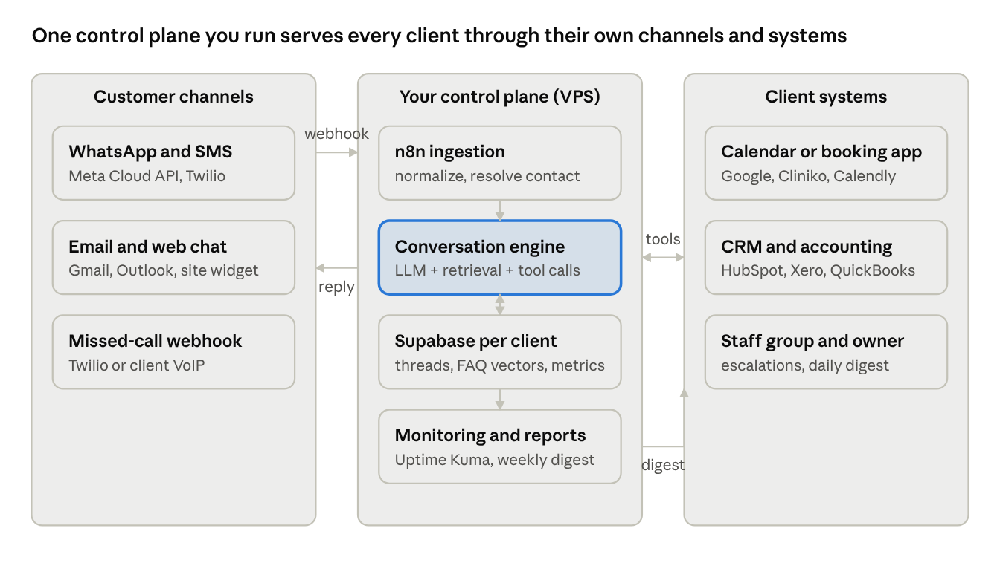

# PLAN — Nuvadesk control plane, template library, dashboard and site

This is the answer to **Prompt 1** in [docs/spec.md §12](docs/spec.md#12-claude-code-prompts-plan-build-in-phases-design-seo). It confirms the architecture, splits the work into three phases, defines `client.json` and the isolation model, lists every account and credential, and ranks the 15 riskiest decisions. Rules for day-to-day work are in [CLAUDE.md](CLAUDE.md).

**Brand.** *Nuvadesk — AI front desk for dental & physio clinics.* The domain is one variable (`DOMAIN` in `infra/.env`, default `nuvadesk.ai`).

**Why Nuvadesk (2026-11-04).** The first working name was "Recallo", but:
- `recallo.ai` was registered on 2026-05-05 (GoDaddy, private owner, expires 2028), and `recallo.com` and `recallo.co` are taken.
- `recallo.co` is a live flashcard product, and an Android **AI business-call assistant named "Recallo"** launched in June 2026. That's too close to a missed-call / AI front-desk product.

Registry RDAP lookups on 2026-11-04 showed `nuvadesk.ai` and `nuvadesk.com` both unregistered. No product uses the exact name; the nearest are "Nuevadesk" (an Indian helpdesk tool) and "NovaDesk ITSM", both in other markets.

| Hostname | Serves |
|---|---|
| `nuvadesk.ai` | Agency website (Phase 3) |
| `app.nuvadesk.ai` | Client dashboard (Phase 3, Vercel) |
| `ops.nuvadesk.ai` | Customer webhooks `/in/*` (core), web chat widget, n8n |
| `status.nuvadesk.ai` | Uptime Kuma |

**Domain requirements checklist (owner: you; nothing is bought yet):**
- [ ] Trademark search for "Nuvadesk" in classes 9/35/42: [IP Australia](https://search.ipaustralia.gov.au/trademarks/search/quick), [USPTO](https://tmsearch.uspto.gov/), [UK IPO](https://trademarks.ipo.gov.uk/ipo-tmtext).
- [ ] Register `nuvadesk.ai` (.ai requires a 2-year minimum registration) and `nuvadesk.com` (defensive; redirect it to `.ai`). Either registrar works, as long as DNS is on Cloudflare (RUNBOOK §1).
- [ ] Before Meta business verification and the Google OAuth consent screen: a homepage and privacy policy live on `nuvadesk.ai` (Phase 3 website).
- [ ] Agency email (Google Workspace or Zoho) on `nuvadesk.ai`. The Resend sender domain goes on a subdomain (e.g. `send.nuvadesk.ai`) with SPF and DKIM.
- [ ] AU SMS: register the business name for alphanumeric sender IDs if you send from "Nuvadesk" rather than a number.

---

## 1. Architecture (confirmed against spec §5)

| Layer | Decision | Notes |
|---|---|---|
| Compute | Hetzner CX22 (2 vCPU / 4 GB), Ubuntu 24.04, Docker Compose | Falkenstein for EU/UK. Ashburn when the first US client signs. Upgrade to CX32 at 10+ clients. |
| Workflow engine | n8n **2.46.4** (current `stable`), Postgres-backed | Postgres **17.11** stores n8n's data only. Client data lives in Supabase. |
| TLS / ingress | Caddy **2.11.7** with the `caddy-dns/cloudflare` plugin (DNS-01) | Certificates issue and renew behind the Cloudflare proxy. Only ports 80 and 443 are open. |
| Monitoring | Uptime Kuma **2.5.9** at `status.<DOMAIN>`, n8n error workflow → Telegram, Sentry (Phase 3 web apps) | |
| Backups | Custom `backup` container: nightly `pg_dump` → Backblaze B2, nightly workflow export → Git | Restore drill in RUNBOOK.md, target under 1 hour. |
| Client data + vectors | Supabase (Postgres + pgvector + Auth + Vault) | One project to start. Add one per region (US / EU / AU) when the first client in that region signs. |
| LLM | Claude Sonnet 5.5 for conversation, Claude Haiku 5.5 for guardrails and classification, OpenAI as outage fallback | Per-client keys with spend caps. Models are named in `client.json`. |
| Embeddings | OpenAI `text-embedding-3-small` (1536-d) | Anthropic has no embeddings endpoint. |
| Messaging | WhatsApp Business Cloud API (Meta), Twilio SMS and voice webhooks, Resend for email | Official APIs only. |
| Dashboard | Next.js on Vercel + Supabase Auth magic links | Phase 3 |
| Website | Claude Design handoff → Next.js on Vercel | Phase 3 |

**Request flow** (as built in Phase 2, see §7).
1. A webhook arrives at `ops.<DOMAIN>/in/<client_id>/<channel>`. Caddy routes `/in/*` to **nuvadesk-core**.
2. Core verifies the signature on the raw body, normalizes the message to `{channel, contact_id, text, attachments, timestamp, metadata}`, dedupes on the provider message ID, resolves or merges the contact, and loads the thread from Supabase.
3. The guardrail classifier (Haiku) runs.
4. Retrieval fetches the top 5 FAQ chunks, then Sonnet runs with tools.
5. Core executes the tool calls (booking, CRM, escalation) with every argument validated.
6. The reply goes out on the same channel; the transcript, metrics and usage are written.
7. Escalations go to staff phones (WhatsApp card or SMS) or a Telegram group. Errors go to the ops Telegram chat.

n8n runs the schedules (reminders, nurture, rollups, reports), the per-client events hook and error alerting.

---

## 2. Phases

### Phase 1 — Control plane (this commit)
**Deliverables**
- `infra/docker-compose.yml`: postgres, n8n, caddy, uptime-kuma, backup.
- `Makefile` and the scripts first-boot, update, backup, restore, hetzner-setup and n8n-bootstrap.
- `RUNBOOK.md`.
- The Telegram error workflow.
- The Supabase base migration.
- `client.schema.json` and the demo clinic config.

**Exit criteria**
- `ops.` and `status.` serve valid TLS.
- A forced workflow error reaches Telegram within a minute.
- The nightly dump lands in B2 and the workflow export lands in Git.
- A timed restore onto a fresh VPS finishes in under 1 hour.

### Phase 2 — Template library, Packages A and B (spec §3, §4.1–4.9), built
The logic lives in **nuvadesk-core** (TypeScript, `core/`), so it can be unit-tested and QA'd without Docker. n8n stays a thin layer. See §7 for the design decisions.

| Module | Where | Package |
|---|---|---|
| 4.1 Channel ingestion | `core/src/ingest/*`: WhatsApp, Twilio SMS, missed-call voice, web chat (+ `webchat/widget.js`), lead forms | A, B |
| 4.2 Conversation engine | `core/src/engine/*`, `core/src/llm/*`: guardrail → retrieve → Sonnet + tools → price guard → reply | A, B |
| 4.3 Booking | `core/src/booking/*`: Google Calendar, Cliniko, Acuity, Microsoft Bookings, Calendly; Jane = link-out. Reminders and no-shows in `jobs.ts` | A |
| 4.4 Lead qualification | `core/src/leads.ts`: questions, scoring, routing, nurture, speed-to-lead | B |
| 4.5 CRM sync | `core/src/crm/*`: HubSpot, Pipedrive, GoHighLevel, Google Sheets | A, B |
| 4.6 Document capture | deferred (Package C) | — |
| 4.7 Reviews | deferred (Package C) | — |
| 4.8 Reporting | `core/src/reporting.ts`: nightly `metrics_daily` rollup, weekly owner report, daily digest | A, B |
| 4.9 Escalation | `core/src/escalation.ts`: staff card + "I'll take it", claim, relay, 2-hour AI pause, owner backup | A, B |

Plus:
- `n8n/templates/packages/`: the core schedules and the per-client events workflow.
- `scripts/new-client.ts`: validates `client.json`, upserts the Supabase row, stores secrets in Vault, embeds the FAQ, creates the n8n events workflow, and prints every URL to configure.
- `qa/`: the 50-conversation QA suite (`npm run qa`, `npm run qa -- --live`).
- `config/clients/demo-clinic.json`: the demo clinic (fill the `REPLACE_WITH_*` values to go live).

**Exit criteria** (status in §7)
- The demo clinic books a real Google Calendar slot over WhatsApp.
- The QA suite passes at least 48 of 50.
- p95 response time is under 10 s.

### Phase 3 — Client dashboard and agency website (Prompts 4–5)
- **Dashboard:** magic-link auth; agency / owner / staff roles; metrics over time; transcript search; the approval queue (Package D); invoices and the walkthrough video.
- **Website:** Claude Design handoff; package, vertical and case-study pages; demo number; Cal.com; MDX blog; JSON-LD, sitemap, hreflang (en-AU / en-GB / en-US); Lighthouse mobile 95+.

**Exit criteria**
- Screenshots reviewed.
- Lighthouse 95+.
- An RLS test shows staff of client A cannot read client B.

---

## 3. `client.json` and the isolation model

**Schema.** [config/client.schema.json](config/client.schema.json) (JSON Schema 2020-12). Example: [config/clients/demo-clinic.json](config/clients/demo-clinic.json). Every behaviour that differs between clients lives in this file, so a new client means a new file plus credentials, not code.

| Block | Holds |
|---|---|
| identity | `client_id` (slug), `name`, `vertical`, `region` (us/eu/au), `timezone`, `locale`, `packages`, `care_plan` |
| `business` | address, phone, website, hours per weekday, holidays, services with prices and durations, policies (cancellation, payment, insurance), staff bios |
| `channels` | WhatsApp (phone ID, credential ref), SMS (Twilio number, sub-account credential ref), web chat (allowed origins), missed-call (provider, text-back delay) |
| `assistant` | persona name, tone, disclosure text, languages, forbidden topics, after-hours mode, emergency text, confidence threshold, `llm` (primary / classifier / fallback model + credential ref + monthly cap) |
| `booking` | adapter + credential ref, calendars, buffer minutes, new-patient cutoff, reminder offsets, no-show follow-up delay |
| `lead_qualification` | questions (id, text, type, options, weight), thresholds for hot/warm, nurture sequence |
| `crm` | adapter + credential ref, field mapping, source-of-truth rules |
| `escalation` | channel (`whatsapp_staff` / `telegram` / `sms`), staff names and phones, owner backup, claim timeout, AI pause minutes (120) |
| `reporting` | owner recipients, weekly day and time, revenue per booking for the "revenue influenced" estimate |
| `compliance` | country regime (TCPA / Spam Act / PECR), consent text, STOP keywords, retention months (12), PHI-minimization flag |

**Credential references.** Secrets are never stored in `client.json`. Fields named `credential` hold a reference `<client_id>/<name>`. That reference is the name of an n8n credential (or a Supabase Vault secret) in the client's own n8n project.

**Isolation model.**
| Layer | Isolation |
|---|---|
| n8n | Per-client workflows are tagged `client:<id>` and prefixed with the client id. n8n *projects* need a paid n8n plan, so they aren't used. Client credentials don't live in n8n; they are in Supabase Vault (below). Partner-plan or large clients can still get their own n8n container (~300 MB RAM). |
| Supabase | One shared schema. **`client_id` on every table, RLS on every table.** n8n writes with the service role. Dashboard users read through RLS, keyed on `user_roles` (agency / owner / staff). This is spec §11's wording, and it keeps the dashboard to one query path. Data residency comes from the region's Supabase project. |
| Secrets | n8n credential store (encrypted with `N8N_ENCRYPTION_KEY`) plus Supabase Vault. One set per client, nothing shared. |
| Messaging | WhatsApp number per client, Twilio sub-account per client. |
| LLM | Anthropic: a **workspace per client** with a workspace spend limit, and a key in that workspace. OpenAI: a **project per client** with a budget. Usage is logged to `usage_events` for pass-through billing. |
| Webhooks | `/in/<client_id>/<channel>`, signature-verified per provider (Meta app secret, the client's own Twilio auth token, per-client derived tokens for lead forms and Telegram). |

---

## 4. Accounts and credentials to create

| Account | Credential | Scope / setting | Stored in |
|---|---|---|---|
| GitHub | Deploy key (ed25519) on this repo | **Write** (the backup container pushes workflow exports). Repo stays private. | VPS `infra/secrets/deploy_key`, never committed |
| Hetzner Cloud | Console login + SSH key | Project "nuvadesk". SSH key auth only. | Your password manager |
| Cloudflare | API token | `Zone:DNS:Edit` on the one zone only (Caddy DNS-01) | `infra/.env` `CLOUDFLARE_API_TOKEN` |
| Backblaze B2 | Application key | Restricted to bucket `nuvadesk-backups`, read+write, no list-all-buckets | `infra/.env` `B2_*` |
| Telegram | Bot token (BotFather) + chat ID of your alerts chat | Bot only posts | `infra/.env` → n8n credential |
| n8n | Owner account + public API key | API key for bootstrap and workflow export | `infra/.env` `N8N_API_KEY` |
| Supabase | Project per region: `service_role` key (n8n only), `anon` key (dashboard), DB connection string (backups) | Service role never leaves the server | n8n credential / Vercel env / `infra/.env` |
| Anthropic | Org + **one workspace per client** with a monthly spend limit, plus one key per workspace. A separate "agency-demo" workspace for demos. | Key per client | n8n credential `<client_id>/anthropic` |
| OpenAI | One project per client with a monthly budget and a project key (fallback + embeddings) | Project-scoped key | n8n credential `<client_id>/openai` |
| Twilio | Main account + **sub-account per client**, a number per client | Sub-account SID + auth token. Webhook signature validation uses the sub-account token. | n8n credential `<client_id>/twilio` |
| Meta Business | Business Manager, WhatsApp Business Account per client, **system user** token | `whatsapp_business_messaging`, `whatsapp_business_management`. App secret for `X-Hub-Signature-256`. | n8n credential `<client_id>/whatsapp` |
| Resend | Domain-verified sending key | Send-only, per sending domain | n8n credential |
| Google Cloud | OAuth client for Calendar/Sheets (per client consent) | `calendar.events`, `spreadsheets` only | n8n credential `<client_id>/google` |
| Sentry | Org + project per web app | DSN only | Vercel env (Phase 3) |
| Vercel | Team + projects (dashboard, site) | Git integration | Vercel |
| Cal.com, PayPal Business, Payoneer, Wise | Sales and finance accounts | — | Password manager |

---

## 5. The 15 riskiest decisions

| # | Risk | Decision / mitigation |
|---|---|---|
| 1 | **Prompt injection** (customer text steers the LLM into leaking the prompt, promising discounts, or calling tools wrongly) | A Haiku guardrail classifier runs *before* the main call. Customer text is passed only as user content, never concatenated into the system prompt. Tools validate every argument server-side (n8n), e.g. only slots that `check_availability` actually returned can be booked. No tool can send to an arbitrary number. |
| 2 | **Escalation reliability** (a human never sees the handover) | The escalation card goes to the staff group *and* writes an `escalations` row. If no one claims it within 10 minutes, a second ping goes to the owner. Unclaimed escalations appear in the daily digest. The customer always gets an honest "a team member will reply" message. |
| 3 | **Webhook authenticity** | Verify Meta `X-Hub-Signature-256` (app secret), Twilio `X-Twilio-Signature` (sub-account token), and an HMAC on the web-chat widget. Reject unsigned requests before any processing. |
| 4 | **PII / PHI minimization for clinics** | Store name, phone, email and appointment time. The assistant is instructed not to ask about symptoms. US clinics set `phi_minimization: true`, which also redacts free-text health details before storage. Transcripts are purged after 12 months. |
| 5 | **TCPA / Spam Act / PECR consent** | Transactional messages (confirmations, reminders) are allowed. Marketing and nurture messages require `contacts.consent_marketing_at`. STOP / UNSUBSCRIBE / CANCEL are honoured on every channel, write `opted_out_at`, and block further sends. |
| 6 | **WhatsApp 24-hour window** | Free-form replies only inside the window. Outbound reminders and nurture use pre-approved templates. Submit templates at client kickoff, because approval can take days. |
| 7 | **AI disclosure** | The first message in every thread includes `assistant.disclosure_text`. This is enforced in the workflow, not left to the model. |
| 8 | **LLM outage / price change** | Anthropic primary, OpenAI fallback configured per client. If both fail, the customer gets a fixed "we'll call you back" message and an escalation is created. More than 3 failures in an hour sends a Telegram alert. |
| 9 | **Runaway spend** (loops, abuse) | Provider-side caps (Anthropic workspace limit, OpenAI project budget, Twilio sub-account limits). An app-side monthly cap is checked against `usage_events`. Per-contact rate limit of about 30 messages per hour. |
| 10 | **Double booking / duplicate writes** | Dedupe inbound on provider message ID. Booking writes are idempotent on `(client_id, adapter, external_booking_id)`. Availability is re-checked immediately before writing. CRM writes are keyed on the external contact ID. |
| 11 | **Hallucinated prices or medical/legal advice** | Prices come only from `business.services`, injected into the prompt. Forbidden-topics list. Retrieval-grounded answers. Below the confidence threshold the assistant escalates instead of guessing. The QA suite includes adversarial cases. |
| 12 | **Data residency** | One Supabase project per region, created when the first client there signs. `client.region` selects the project. The n8n VPS holds only transient execution data, with execution pruning on. |
| 13 | **Backup / restore actually works** | Nightly dumps to B2 with 30-day retention. Workflows also go to Git. A timed restore drill before the first client, then quarterly, recorded in RUNBOOK.md. |
| 14 | **Secrets leaking into Git or logs** | `.gitignore` blocks env files and keys. `client.json` holds references only. Pinned data (`pinData`) is stripped from workflow exports. Pre-commit review of `git diff --cached`. n8n blocks `$env` access in nodes. |
| 15 | **Single VPS = single point of failure** | Uptime Kuma checks every minute. The restore-in-1-hour runbook is drilled. Spec §4's 99.5% target allows about 3.6 hours a month. Revisit a warm standby at 10+ clients. |

---

## 6. Open questions
Phase 2 went ahead on the recommended defaults: Supabase in Sydney (`ap-southeast-2`), Google Calendar first and Cliniko second. Still open:
1. **Domain:** is `nuvadesk.ai` (or `nuvadesk.com.au` / `getnuvadesk.com`) available and acceptable, or do you want a different brand?
2. **OpenAI fallback model:** `gpt-5-mini` in the demo config is a placeholder. Confirm the model ID and its price (`core/src/llm/pricing.ts`) against your OpenAI account.
3. **Telegram:** the bot and alerts chat are needed for the Phase 1 error workflow and core alerts.

---

## 7. Phase 2 as built (2026-11-04)

**Design decisions**
| Decision | Why |
|---|---|
| Logic in a TypeScript service (`core/`) rather than inside n8n | Testable without Docker (72 unit tests, 50-conversation QA locally). Tool inputs are validated in code. Signature checks need the raw request body, which an n8n hop makes fragile. |
| Inbound webhooks go to core at `/in/<client_id>/<channel>` | Same reasons. n8n keeps schedules (`/v1/jobs/*`), a per-client events webhook (`<client_id>/events`) for custom automations, and error alerts. |
| Node 26 runs the `.ts` sources directly | No build step; the Docker image copies `core/src` and runs `node core/src/main.ts`. |
| Claude Sonnet 5.5, effort `low`, manual tool loop (max 6 iterations), server-side refusal fallback | Chat latency and cost. The loop validates every tool input and caps cost. The fallback handles safety-classifier refusals. |
| Per-turn facts as a mid-conversation system message | The per-client system prompt stays byte-identical, so it caches, and customer text never mixes with operator instructions. |
| Code-enforced guards: AI disclosure, STOP/START (whole message only), WhatsApp 24h window, invented-price check, new-patient cutoff, offered-slot-only booking, spend cap, rate limit, degraded mode after >3 failures/hour | These shouldn't depend on the model following instructions. |
| Escalation to staff phones (`whatsapp_staff`) or a Telegram group, not a WhatsApp group | The WhatsApp Cloud API can't post into groups. Staff get a template card with an "I'll take it" button (or SMS with `TAKE <code>`). |
| Jane in link-out mode | Jane's API is partner-gated and documents no booking endpoint. The assistant sends `booking.booking_link` instead. |
| Calendly books through `POST /invitees` | Calendly's Scheduling API, available on paid Calendly plans. |
| Client secrets in Supabase Vault (`put/get_client_secret`, service-role only) | Core and `new-client.ts` share them; nothing is copied into n8n per client. |

**Exit criteria status**
| Criterion | Status |
|---|---|
| QA suite passes ≥ 48/50 | Mock models: **50/50**. Live run (`npm run qa -- --live`, about USD 1–3): **not run yet**, needs your Anthropic key. |
| Demo clinic books a real Google Calendar slot over WhatsApp | **Not done.** Needs the Supabase project, Meta number, Google OAuth client and VPS deploy (RUNBOOK §9). |
| p95 response under 10 s | **Not measured.** Needs live traffic; `metrics_daily.p95_response_seconds` records it. |

**Verified only against documentation and HTTP fakes, not live accounts:** Cliniko, Acuity, Microsoft Bookings, Calendly, HubSpot, Pipedrive, GoHighLevel, Google Sheets, Resend, the Twilio and WhatsApp send formats, and the n8n template imports. Each gets verified on the client's integration days (spec §6.3, days 4–6).

---

## 8. Pre-Phase-3 gate (2026-11-04)

| Item | Status |
|---|---|
| Domain | **Rebranded to Nuvadesk** (§ Brand at the top). `nuvadesk.ai` / `nuvadesk.com` were unregistered on 2026-11-04. **Not bought yet**; that's on you (checklist above). |
| `gpt-6-luna` fallback | **Compatible in code.** The fallback runs on the Responses API (gpt-6-luna only supports tools on Chat Completions with reasoning off). Official price is $0.10 / $0.50 / $0.01 cached per 1M tokens. **Not finalized:** `demo-clinic.json` keeps `gpt-5-mini` until `npm run qa -- --live --model openai:gpt-6-luna` scores ≥ 48/50 with no safety failures. |
| Live QA (Claude Sonnet 5.5) | **Deferred to the pre-launch gate** (§9): it needs paid API credit. Mock QA (50/50) is the development gate. |
| Provider checks | `scripts/check-integrations.ts` is ready for Anthropic, OpenAI, Google Calendar and Sheets, and Telegram. Twilio, WhatsApp, Resend and Cliniko are read-only probes, skipped until configured. **Passed:** Google Calendar and Google Sheets, read and `--write` (2026-11-04). Telegram deferred until after Phase 3. Anthropic and OpenAI wait for the pre-launch gate. |
| Docker verification | **Green in GitHub Actions** (run 41839570279, all three jobs). `ci.yml` has three jobs. The `docker` job builds all images, starts the stack healthy, checks routing through Caddy and the job-token auth, and imports every n8n template on 2.46.4. The `supabase` job applies all migrations on a real local Supabase and passes the integration suite (Store, Vault RPCs, pgvector, concurrent claim, RLS isolation, retention purge). Production TLS through Cloudflare DNS-01 is still unverified until the domain and VPS exist. |
| Design skills | `.claude/skills/frontend-design` (Anthropic, Apache-2.0) and `.claude/skills/ui-ux-pro-max` (v2.15.0, MIT): reviewed, pinned, with provenance in `SOURCE.md`. A new Claude Code session picks them up. |

---

## 9. Development runs on free tiers only (decided 2026-11-04)

**Rule.** Until you say otherwise, development spends nothing:
- no purchases, subscriptions or prepaid API credit
- no free trials that need a payment card

Anything that needs money is **deferred** to a pre-launch gate, not worked around with a different paid service. Where a paid API would be called, development uses the mock models (`npm run qa`, the unit tests).

| Item | Free path during development | Deferred until the pre-launch gate |
|---|---|---|
| Domain | No domain. Use `localhost`; when a public URL is needed for webhooks, a free Cloudflare quick tunnel (`cloudflared tunnel --url http://localhost:8080`, no account, random `*.trycloudflare.com` URL). | Buy `nuvadesk.ai` + `nuvadesk.com` (checklist at the top) |
| Server / Docker | No VPS. The Docker stack is verified in GitHub Actions on every push (free for public repos; private repos get the free plan's monthly minutes). For a local stack, use Docker Engine inside WSL2 or Podman: both free and open source. Docker Desktop needs a paid subscription at larger companies. | Hetzner VPS, real TLS via Cloudflare DNS-01 |
| LLMs (Claude, OpenAI) | Mock models only. Neither API has a free tier. | Live QA on Claude Sonnet 5.5 (≥ 48/50), then the `gpt-6-luna` evaluation; finalize the fallback per §8 |
| Google Calendar + Sheets | **Do now.** Free: a Google Cloud project with no billing account, OAuth consent screen in Testing mode, Desktop OAuth client. Testing-mode refresh tokens expire after 7 days; re-run `node scripts/google-oauth.ts` when that happens. | — |
| Telegram | Free; **deferred until after Phase 3**. | — |
| Supabase | Local Supabase in CI (already green). A free-plan cloud project when the dashboard needs a hosted database (free projects pause after a week idle). | Paid plan, per-region projects |
| n8n, Uptime Kuma, Caddy | Self-hosted community editions, free. | — |
| Twilio, WhatsApp, Cliniko, Resend | Not set up. Revisit free sandbox or test options (e.g. Meta's WhatsApp test number) only when a feature needs them. | Real numbers, sender verification, client accounts |
| Backups (B2) | Off (`backup` profile; nothing to back up yet). | B2 bucket + restore drill |
| Phase 3 hosting | Run the dashboard and website locally. Vercel Hobby is free but non-commercial only, so production hosting is decided at launch. | Production hosting, Sentry, Cal.com |

**Phase 3 gate, adjusted for free-only development** (proposed, overriding the "after live QA" ordering in §8):
- Phase 3 starts once:
  - CI is green (done)
  - mock QA is 50/50 (done)
  - Google Calendar and Google Sheets pass `check-integrations` (read and `--write`): **done 2026-11-04**
- **Telegram is deferred until after Phase 3** (your call, 2026-11-04). It only carries ops alerts and the optional Telegram escalation channel; the demo clinic escalates via `whatsapp_staff`, and nothing in the dashboard or website depends on it. Setup steps stay in RUNBOOK §12.5.
- Live LLM QA and the `gpt-6-luna` decision move to the **pre-launch gate**, before the first paying client.

---

## 10. Phase 3 as built (2026-11-05)

**What exists**
- **Database** (`supabase/migrations/20261107000000_dashboard.sql`, `20261108000000_enquiry_hours.sql`):
  - New tables: `reply_drafts`, `invoices`, `client_resources`.
  - Staff can no longer read money: `metrics_daily` is owner/agency only, and `dashboard_metrics` nulls cost and revenue for staff.
  - RPCs: `my_memberships`, `search_messages` (on the indexed text expression), `decide_reply_draft` (the only write, with an audit row), `agency_health`, `enquiry_hours`, `enquiries_by_day` (after hours judged against each clinic's own hours and holidays).
- **Dashboard** (`dashboard/`, Next.js 16, port 3000):
  - Magic-link sign-in, agency / owner / staff roles.
  - Overview: range picker, KPIs, enquiries split by opening hours, a week-by-hour heatmap, reply time, bookings, leads.
  - Conversation search with highlighted matches, transcripts, the Package D approval queue, billing (owner and agency), help and walkthrough, agency health.
  - Light and dark, phone to desktop. All reads run as the signed-in user, so RLS decides what they see; the service role never reaches the app.
- **Website** (`site/`, Next.js 16 + MDX, port 3001):
  - Home, 4 package pages, 5 industry pages, a labelled demo case study, about, contact (Cal.com when configured), privacy.
  - en-AU at the root, plus `/en-gb` and `/en-us`, with hreflang.
  - JSON-LD (Organization, Service, FAQPage, BlogPosting), sitemap, robots, Open Graph image.
  - A 12-post calendar with 3 posts written.
  - Designed here (no Claude Design handoff, your call); the design system is in `design-system/nuvadesk/MASTER.md`.
- **Hosted dev database:** free Supabase project (Seoul), migrations applied with `scripts/db-push.ts`, two fictional demo clinics seeded with 90 days of activity (`scripts/seed-demo.ts`).
- **Scripts:**
  - `invite-user.ts`, `dev-login.ts`
  - `screenshots.ts`
  - `site-smoke.ts` (in `validate.sh`, so CI runs it)
  - `lighthouse.ts` (CI job `lighthouse`)
- **Docs:** RUNBOOK §13 (running both apps), `docs/marketing/seo.md` (Search Console steps and the first 10 backlinks).

**Exit criteria status**
| Criterion | Status |
|---|---|
| RLS: staff of client A cannot read client B | **Passed.** 9 integration tests in `core/test/integration/dashboard.int.test.ts`, green in the CI `supabase` job. They cover cross-client reads, money hidden from staff, scoped search, drafts decided once and only by their own client, and anonymous callers. Also checked by hand in the running dashboard as staff. |
| Screenshots reviewed | **Done.** You reviewed both apps (2026-11-05) and asked to carry on. Polish after review: the date-range picker fits one row on phones, conversation previews use the full width, and long clinic names wrap. |
| Lighthouse mobile 95+ | **Passed.** CI job `lighthouse` (run 41971476052, clean GitHub runner, median of 3 runs): home, `/packages/receptionist`, `/for/dental` and the missed-calls blog post all score **Performance 99, Accessibility 100, Best practices 100, SEO 100**. The job fails under 95 on every push. On this laptop, runs swing between 66 and 99 because the machine is busy (Lighthouse flags the host as overloaded); accessibility, best practices and SEO were 100 there too. |

**Decisions made while building**
| Decision | Why |
|---|---|
| Recharts for the dashboard charts | Accessible SVG, custom legend and tooltip; chart colours checked with the dataviz validator for colour blindness and contrast in both themes. |
| Website CSS inlined (`experimental.inlineCss`) | The stylesheet is about 6 KB, so inlining removes the only render-blocking request. |
| Website has almost no JavaScript of its own | The hero animation is CSS only; the Cal.com embed loads only on click. What remains is Next's runtime. |
| Demo number, hero video, Cal.com and hosting are optional through env vars | All are paid or need accounts (PLAN §9); the site shows a labelled sample conversation and an email call to action until they're set. |

**Before launch (added to the pre-launch gate)**
- **Privacy policy legal review.** `/privacy` is written to match what the system actually does, but it is a draft. Have a lawyer in each market review it (Australian Privacy Act / APPs, UK GDPR, US state laws) before it goes live. Meta business verification and the Google OAuth consent screen both need it live on the real domain.
- Hosting for both apps (Vercel Hobby is non-commercial only), `NEXT_PUBLIC_SITE_URL`, and a custom SMTP sender for magic links (Supabase's free sender is a few emails per hour).
- Search Console and the backlink list in `docs/marketing/seo.md`, on launch day.

**Redesign and interaction pass (2026-11-05, after your review)**
- **New look:** "Bright & friendly" (teal, marigold, mint, night; Bricolage Grotesque + Figtree), and the "N thread" logo. Details are in `design-system/nuvadesk/MASTER.md` v2.
- **Website:**
  - a try-it demo chat, scripted from the demo clinic's real config and FAQ, with 9 unit tests
  - a missed-calls calculator, using the visitor's own numbers and labelled as an estimate
  - smoother FAQ and menus
- **Dashboard:**
  - a 4-step tour and a getting-started checklist
  - "What is this?" on every KPI
  - heatmap cells open their conversations (new RPC `threads_in_hour`, with an RLS test)
  - a conversation preview drawer
  - approvals with a 5-second Undo and J/K/A/E/R shortcuts
  - a Ctrl+K command palette, and `?` for shortcuts
- **Checks:** CI stayed green with Lighthouse ≥ 95 on every sample page. Each flow was checked in a real browser: Undo leaves the draft pending, and a heatmap cell lists exactly its own conversations.
- **Design skills:** frontend-design and UI UX Pro Max are installed at user level (`~/.claude/skills`), so they load in every session.

---

## 11. Phase 4: launch-ready, free (planned 2026-11-05, not started)

**Goal:** everything that can be done before the first client without spending money, so that when a clinic says yes, the only remaining steps are the paid ones in §12.

| # | Work | Output | Done when |
|---|---|---|---|
| 4.1 | Telegram alerts (deferred from Phase 2) | Bot + alerts group (RUNBOOK §12.5); `TELEGRAM_*` in `.env.local` | `node scripts/check-integrations.ts --write` sends the test message |
| 4.2 | Your own agency login | `node scripts/invite-user.ts <your email> --agency`, run by you (Claude Code asks you to grant access yourself) | You sign in at /login with a magic link |
| 4.3 | Intake questionnaire | `docs/delivery/intake.md`: every question needed to fill `client.json` (hours, services and prices, policies, staff, booking system, channels, escalation contacts), in plain language for the clinic | A fictional clinic's answers convert to a `client.json` that validates against the schema |
| 4.4 | Prompt 6 rehearsal on a fictional client | "Bayside Family Physio" (Brisbane, Package A, Google Calendar): `config/clients/rehearsal-physio.json` from 4.3, `scripts/new-client.ts` against the hosted Supabase (status `demo`), a 50-conversation mock QA run for it, and the dashboard showing it | New client provisioned, QA ≥ 48/50 on mock models, visible to the agency user, and nothing edited in the templates by hand |
| 4.5 | Delivery templates (what Prompt 6 asks for) | `docs/delivery/`: UAT checklist, staff training outline (60 minutes, matching the website's promise), go-live checklist, change-request template | Used in full in the 4.4 rehearsal |
| 4.6 | Scope check | `scripts/scope-check.ts`: reads a requirements list (one per line) and the client's packages, and flags anything outside `site/src/content/packages.ts` "includes" as a change request, with the package that would cover it | Flags at least: voice calls, a second location, a custom CRM, and payments, on the rehearsal client (Package A) |
| 4.7 | Sales kit | `docs/sales/`: one-page scope/proposal template (promised on the site), scripts for the two demo videos (spec §9), outbound message templates for the 20-a-day routine (spec), discovery-call agenda | Recording the demo videos needs only OBS (free) and the running demo |
| 4.8 | Free accounts that need no card | Cal.com free plan for the contact page (`NEXT_PUBLIC_CAL_LINK`), Loom free for the walkthrough video. Confirm each one asks for no payment card before signing up (PLAN §9) | The contact page shows the booking embed locally |

**Exit criteria**
- The 4.4 rehearsal runs end to end from the intake answers, and every document in `docs/delivery/` was used in it.
- Telegram receives the test alert.
- You can sign in to the dashboard as yourself.
- CI is green.

---

## 12. Pre-launch gate: the paid steps, in order (do each only when you say)

Costs are from the spec where it gives them; anything else is "check at signup", not a guess.

| # | Step | Why it's needed | Cost |
|---|---|---|---|
| 12.1 | Domain: `nuvadesk.ai` (2-year minimum) + `nuvadesk.com`, with DNS on Cloudflare (free) | Website, email, webhooks, Meta and Google verification | Check at the registrar (.ai is priced per 2 years) |
| 12.2 | VPS (Hetzner CX22/CX32) | Runs n8n, nuvadesk-core, Caddy, Uptime Kuma. The dashboard and website can run here too, as Docker containers, instead of on Vercel (whose free Hobby plan is non-commercial only) | USD 6–15/month (spec §5) |
| 12.3 | Website and dashboard live | `NEXT_PUBLIC_SITE_URL`, then Search Console and the backlink list (`docs/marketing/seo.md`) | Included in 12.2 if self-hosted |
| 12.4 | Email: agency mailbox + Resend sender on `send.<domain>` | Magic links beyond Supabase's few-per-hour, the weekly owner report | Mailbox: check at signup. Resend has a free tier (needs the domain) |
| 12.5 | Live LLM QA: Claude Sonnet 5.5 ≥ 48/50, then the `gpt-6-luna` fallback decision (§8) | Proves the prompt and guards with the real model before a clinic depends on it | About USD 1–3 per QA run (prepaid API credit) |
| 12.6 | WhatsApp Business number (Meta) + Twilio number for SMS and missed calls, starting with the demo clinic | The live demo number on the website, and the first client's channels | Per number and per message (pass-through to clients). Check at signup |
| 12.7 | Sentry free tier on both web apps | Errors reach you before the client notices | USD 0 (spec §5) |
| 12.8 | Backups: Backblaze B2 bucket + restore drill (RUNBOOK §6c) | Restore in under an hour | Small; check at signup |
| 12.9 | **Rotate the secrets pasted into chat** | The Supabase secret key and the Google OAuth client secret were pasted into a chat on 2026-11-04/05. Replace both before anything goes live: Supabase → Project Settings → API Keys → new secret key → `SUPABASE_SERVICE_ROLE_KEY` → delete the old one; Google Cloud → Auth Platform → Clients → nuvadesk-cli → add a secret → `GOOGLE_OAUTH_CLIENT_SECRET` → delete the old one | Free |
