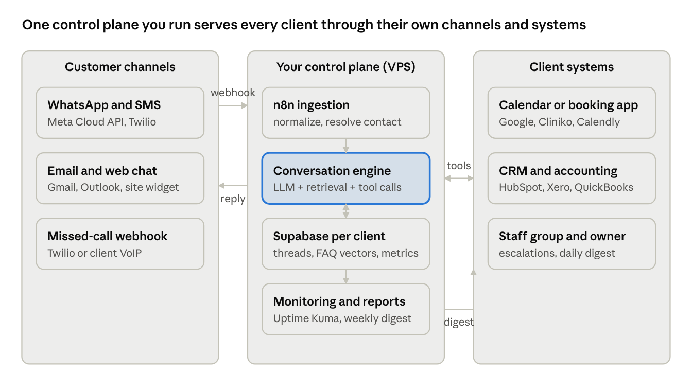

# Project 1 — AI Automation Service for Overseas SMBs

Oct 27, 2026 · @bech

## 1. Executive summary

You sell fixed-scope, fixed-price AI automation systems to small businesses in the US, UK and Australia, then keep them on a monthly retainer. Target: 3–4 retainers plus 2 setups a quarter reaches LKR 1M/month (about USD 3,000) within 4–9 months, on under LKR 150K of startup cost.

Working name: a one-word brand plus a vertical tagline, e.g. "LoopDesk — AI front-desk automation for dental clinics". Pick the brand after you pick the vertical (Section 2).

What the customer buys: a working system, not hours. Each package has a fixed deliverable list, a fixed price, a 14-day delivery window and a monthly care plan. The customer never sees n8n, Supabase or an API key; they see a WhatsApp number that answers, a calendar that fills, and a weekly report.

Why this works from Sri Lanka in 2026:

- Service-export income remitted through a Sri Lankan bank is taxed at a maximum of 15%, versus up to 36% on local income.
- PayPal (since 15 May 2026), Payoneer, Wise and Paddle let you invoice and collect in USD.
- Sri Lanka's working day overlaps Australia's morning and the UK's afternoon, so you can offer same-day responses to both.
- Western SMBs want AI receptionists, lead follow-up and back-office automation, but cannot hire for it. Local agencies charge USD 5,000–15,000 for what you can deliver at USD 1,500–5,000.

What you must have: one vertical, two recorded demos, one landing page, one outbound routine of 20 messages a day, and a Sri Lankan bank account that receives the money.

Business model in one line: Setup fee (USD 1,500–5,000) + care plan (USD 300–1,000/month) + optional usage pass-through (LLM, SMS, voice minutes at cost + 20%).

## 2. Target customers and market

Pick one vertical for the first 6 months. Every demo, case study and outbound message speaks to that vertical only. Broadening too early is the most common reason agencies like this fail to close.

| Vertical | Why they buy | Best first package | Typical budget | Where to find them |
|---|---|---|---|---|
| Dental and physio clinics (US, AU) | Missed calls = lost patients worth USD 500–2,000 each | AI receptionist + booking | USD 2,000–4,000 setup | Google Maps lists, Dental Town, LinkedIn |
| Real-estate agents and small brokerages (US, UK, AU) | Speed-to-lead decides who wins the listing | Lead qualifier + follow-up | USD 1,500–3,000 setup | Zillow/Rightmove agent pages, LinkedIn |
| Home services: plumbers, HVAC, roofers (US) | Owner is on the tools, cannot answer the phone | Missed-call text-back + quote bot | USD 1,500–2,500 setup | Google Maps, Facebook groups, Jobber community |
| Law firms, 1–5 lawyers (US, UK) | Intake is slow and manual | Intake bot + document collection | USD 3,000–5,000 setup | Clio community, LinkedIn, Avvo |
| E-commerce stores, USD 500K–5M revenue (US, UK, AU) | Support tickets and returns eat margin | Support triage + order lookup | USD 2,000–4,000 setup | Shopify app reviews, Twitter/X, eCom Facebook groups |
| Recruitment agencies (UK, AU) | Candidate screening is repetitive | Candidate screener + scheduler | USD 2,500–4,000 setup | LinkedIn, Recruiter forums |

Recommended first vertical: dental/physio clinics in Australia. Reasons: Australian morning = Sri Lankan morning, so you can do live demos; clinics have cash and a clear, measurable pain (missed calls); the market is large but the local automation agencies are expensive.

Ideal customer profile (ICP):

- 1 location, 3–15 staff, owner-operated.
- Already uses a cloud practice-management or CRM system (Cliniko, HubSpot, Jobber, Clio, Shopify) so you can integrate instead of replacing.
- Gets 30+ inbound enquiries a week.
- Owner is on LinkedIn or Facebook and replies to messages.

Market size (directional): Australia alone has about 7,000 dental practices and 30,000+ allied-health clinics. You need 6–10 paying clients to pass LKR 1M/month, so the market is never the constraint; your outbound volume is.

Buyer and user: the owner buys; the receptionist or office manager uses it daily. Design onboarding for the office manager and reports for the owner.

## 3. Service catalogue

Sell four packages and three care plans. Everything else is a custom quote at USD 90/hour, which you rarely take.

### Package A — AI Receptionist (USD 2,500 setup)

- Inbound WhatsApp, SMS and web-chat assistant that answers FAQs (hours, prices, location, insurance, parking).
- Appointment booking, rescheduling and cancellation written directly into the client's calendar or practice system.
- Missed-call text-back: when a call is not answered, the caller receives a text within 30 seconds and can book by chat.
- Human handover: the assistant escalates to a staff WhatsApp group with a summary when it cannot answer.
- After-hours mode with different wording and emergency routing.
- Daily digest to the owner: bookings made, enquiries handled, escalations.
- Optional voice add-on (USD 1,000): an AI phone agent that answers calls, books and transfers.

### Package B — Lead Qualifier and Follow-up Engine (USD 2,000 setup)

- Captures leads from web forms, Facebook Lead Ads, Google Ads landing pages and inbound email.
- Responds within 60 seconds by SMS/WhatsApp/email, asks 3–5 qualifying questions, scores the lead.
- Writes the lead into the CRM (HubSpot, Pipedrive, GoHighLevel, Zoho) with score and transcript.
- Books a call with the owner or sales rep for hot leads; nurtures warm leads over a 14-day sequence.
- Weekly pipeline report with response-time and conversion metrics.

### Package C — Back-office Automation (USD 1,500 setup)

- Invoice and receipt capture: emails and photos become line items in Xero, QuickBooks or MYOB.
- Document collection: sends reminders and files signed documents into Google Drive/Dropbox folders by client.
- Review requests: after a completed job, sends a Google review request and routes unhappy replies to the owner.
- Reporting: a weekly email or Slack post with the 5 numbers the owner cares about.

### Package D — Support Triage for E-commerce (USD 3,000 setup)

- Reads inbound support emails and chats, classifies them (where is my order, return, damaged, pre-sale).
- Answers order-status and policy questions automatically using Shopify/WooCommerce order data.
- Drafts replies for complex cases and places them in the help desk (Gorgias, Zendesk, Freshdesk) for one-click approval.
- Flags refund-risk and chargeback-risk tickets to a human.

### Care plans (monthly)

| Plan | Price | Includes |
|---|---|---|
| Keep-alive | USD 300/month | Hosting, monitoring, API keys, 2 hours of changes, email support within 24 hours |
| Grow | USD 600/month | Keep-alive + 6 hours of changes, monthly optimisation review, prompt tuning, new FAQ training |
| Partner | USD 1,000/month | Grow + 12 hours, one new automation a quarter, Slack/WhatsApp support within 4 hours, quarterly strategy call |

### Usage pass-through

LLM tokens, SMS, voice minutes and WhatsApp conversation fees are billed monthly at cost plus 20%, with a cap agreed in the contract (typically USD 50–150/month). Show the client the raw invoices on request.

### What is always included

- Discovery call (45 minutes) and a written one-page scope before any money changes hands.
- 14-day build, a recorded walkthrough video, and a 30-day bug-fix guarantee.
- Training session for staff (60 minutes, recorded) and a one-page quick guide.
- Client owns their data; you own the automation templates and reuse them.

### What is never included

- Custom front-end web apps, mobile apps, or redesigning the client's website.
- Paid-ads management, SEO, or content writing.
- Anything that requires access to the client's bank or payroll.

## 4. Functional specification of the automation systems

Every client system is assembled from the same nine modules. Build each module once as a reusable template, then configure it per client. This is what makes the service productized rather than bespoke.

### 4.1 Channel ingestion module

- Receives messages from WhatsApp Business Cloud API, Twilio SMS, web-chat widget, Facebook Messenger, Instagram DMs and inbound email (Gmail/Outlook via IMAP or Graph API).
- Normalizes every message into one schema: {channel, contact_id, text, attachments, timestamp, metadata}.
- Deduplicates (same message delivered twice) and merges contacts across channels by phone or email.
- Missed-call detection: Twilio or the client's VoIP (RingCentral, Aircall, 3CX) fires a webhook on an unanswered call; the module triggers the text-back flow.

### 4.2 Conversation engine (the "AI receptionist")

- An LLM (Claude Sonnet or GPT-4-class via API) with a per-client system prompt: business facts, tone, rules, and what it must never say (no medical/legal advice, no pricing promises outside the list).
- Retrieval: client FAQ, price list, policies and staff bios are chunked and embedded in a vector store (pgvector in Supabase); the engine retrieves the top 5 chunks per turn.
- Tools the model can call: check_availability, book_appointment, reschedule, cancel, lookup_order, create_lead, escalate_to_human, send_document.
- Conversation memory: the last 20 turns plus a rolling summary stored per contact.
- Guardrails: a classifier step blocks prompt-injection, profanity, and out-of-scope topics; low-confidence answers escalate instead of guessing.
- Language detection with reply in the customer's language (English default; Spanish and Hindi common in US/UK).
- Business-hours logic: different greeting and escalation path after hours; holidays from the client's calendar.

### 4.3 Booking module

- Adapters for Google Calendar, Microsoft 365 Bookings, Calendly, Cliniko, Jane, SimplePractice, Acuity, Jobber and GoHighLevel calendars.
- Reads availability with buffer rules (e.g. 15 minutes between patients, no new patients after 4 pm).
- Writes the booking, sends a confirmation with an ICS file, and schedules reminders at 24 hours and 2 hours.
- Handles reschedule and cancel by conversation, with the client's cancellation policy enforced.
- No-show follow-up: a message 30 minutes after a missed appointment offering to rebook.

### 4.4 Lead qualification module

- Question script per client (3–7 questions) with branching; answers stored as structured fields.
- Scoring rubric: weighted rules (budget, timeline, location, service fit) plus an LLM judgement, producing Hot/Warm/Cold.
- Routing: Hot → book call + notify rep instantly; Warm → 14-day nurture sequence; Cold → tag and archive.
- Nurture sequences: 5–7 touches across SMS and email, stopping the moment the lead replies.
- Speed-to-lead SLA tracking: time from form submission to first reply, reported weekly.

### 4.5 CRM and systems sync module

- Two-way sync with HubSpot, Pipedrive, Zoho, GoHighLevel, Salesforce Essentials; one-way push to Google Sheets or Airtable for clients without a CRM.
- Field mapping stored per client in a JSON config; every write is idempotent (keyed on external contact ID).
- Conflict rule: CRM is the source of truth for contact details; the automation is the source of truth for conversation transcripts.

### 4.6 Document and data capture module

- Email attachments and WhatsApp images are OCR'd (Google Document AI or an LLM vision call) into structured line items.
- Invoices and receipts pushed to Xero, QuickBooks Online or MYOB as draft bills for approval.
- Signed documents filed to Google Drive/Dropbox/OneDrive in /Clients/{name}/{year} folders; the CRM gets the link.
- Document-collection reminders with a checklist per client type (e.g. new patient: ID, insurance card, consent form).

### 4.7 Review and reputation module

- Trigger on "job complete" or "appointment attended" from the client's system.
- Sends a review request with the client's Google review link; a 1–3 star reply is routed privately to the owner instead.
- Tracks request → click → review rates.

### 4.8 Reporting module

- Weekly owner report (email and optional Slack/WhatsApp): enquiries handled, bookings made, leads by score, response time, escalations, estimated revenue influenced.
- Monthly client dashboard (a simple web page, read-only, behind a magic link) with the same metrics over time.
- Internal health dashboard for you: errors, API spend per client, message volume, uptime.

### 4.9 Human-in-the-loop and escalation module

- Escalation sends a summary card to a staff WhatsApp group or Slack channel with a one-tap "I'll take it" button.
- Staff reply from their own phone; the module relays the reply to the customer and pauses the AI for that thread for 2 hours.
- Approval queue for drafted replies (used in Package D): a web view listing drafts with Approve / Edit / Reject.
- Full transcript log is searchable by the client for 12 months.

### Non-functional requirements

- Response time under 10 seconds for 95% of messages.
- Uptime 99.5% monthly; alerts to you within 5 minutes of a failed workflow.
- All secrets per client stored encrypted; no shared API keys across clients.
- Data residency: client data stored in the region they choose (US, EU or AU Supabase/AWS region).
- Every automated message is labelled as automated where the law requires (e.g. Australian Spam Act, US TCPA consent for SMS).

## 5. Technical architecture and stack

One shared control plane that you run, plus an isolated workspace per client. Total infrastructure cost at 10 clients: about USD 60–120/month before pass-through usage.

### Stack choices

| Layer | Choice | Why | Monthly cost |
|---|---|---|---|
| Workflow engine | n8n (self-hosted, Docker) | Visual, fast to configure per client, 400+ integrations, no per-task fees | USD 0 (on your VPS) |
| Compute | Hetzner CX22/CX32 VPS, Ubuntu 24, Docker Compose, Caddy for TLS | Cheapest reliable EU/US compute; one box runs 10–20 client workspaces | USD 6–15 |
| Database and vectors | Supabase (Postgres + pgvector + Auth + Storage) | Free tier to start; RLS gives per-client isolation; one project per region | USD 0–25 |
| LLM | Anthropic Claude Sonnet or OpenAI GPT-4-class via API; Haiku/mini for classification | Quality for conversation, cheap model for routing | Pass-through |
| Voice (optional) | Vapi or Retell AI + Twilio numbers | Managed speech-to-speech, fastest way to ship phone agents | Pass-through |
| Messaging | WhatsApp Business Cloud API (Meta), Twilio SMS, Resend/Postmark email | Official APIs; avoid unofficial WhatsApp libraries | Pass-through |
| Web chat widget | Open-source widget (e.g. Chatwoot) or a 200-line custom JS snippet | Embeds on any client site | USD 0 |
| Client dashboard | Next.js on Vercel free tier, Supabase Auth magic links | Read-only metrics; low maintenance | USD 0 |
| Monitoring | Uptime Kuma (self-hosted), n8n error workflow → Telegram/Slack, Sentry free tier | Know before the client does | USD 0 |
| Secrets | n8n credentials store + Supabase Vault; one set per client | No shared keys | USD 0 |
| Backups | Nightly Postgres dump to Backblaze B2; n8n workflows exported to a private Git repo | Restore within 1 hour | USD 1–3 |
| Your tooling | GitHub, Notion or Linear, Loom, Cal.com, Google Workspace | Delivery and sales | USD 0–20 |

### Per-client isolation

- Each client gets an n8n project (or a separate n8n instance via Docker for larger clients), its own Supabase schema with row-level security keyed on client_id, its own WhatsApp number and Twilio sub-account, and its own LLM API key with a spend cap.
- Configuration lives in one client.json per client: business facts, hours, calendars, CRM mapping, escalation contacts, tone. Templates read this file so a new client is mostly configuration.

### Request flow (the diagram below)

- A message or missed-call webhook arrives at the ingestion workflow.
- The message is normalized, the contact resolved, and the thread loaded from Supabase.
- The conversation engine retrieves FAQ chunks, calls the LLM with tools, and executes any tool calls (booking, CRM, lookup).
- The reply is sent back on the same channel; the transcript and metrics are written.
- Escalations go to the staff group; errors go to your monitoring channel.



Messages enter from the left, the control plane in the middle does the thinking, and the client's own systems on the right are only read and written through tool calls; the client never needs to log in to anything you run.

### Security and data handling

- TLS everywhere; webhooks verified by signature (Meta, Twilio, Stripe-style HMAC).
- PII minimization: store only what the automation needs; purge transcripts after 12 months by default.
- Data processing agreement (DPA) template signed with every client; for US health clinics avoid storing protected health information beyond name, phone and appointment time, and say so in the contract.
- Role-based access: you, the client owner, and client staff have separate logins to the dashboard.

### Reusable template library (your real asset)

Keep a private Git repo of exported n8n workflows, prompts, client.json schema, SQL migrations, and the dashboard. Version it. Every client build should start from the library and take under 3 working days of configuration; the rest of the 14 days is testing and training.

## 6. Internal business systems

Run the agency on the same tools you sell. Your own sales and delivery process should be automated by week 4, both to save time and to be the demo.

### 6.1 Sales pipeline

| Stage | Entry criterion | Your action | Tool |
|---|---|---|---|
| Prospect | Fits ICP, found on LinkedIn/Maps | Add to list with name, role, pain hypothesis | Google Sheet or Notion CRM |
| Contacted | First personalized message sent | 3-touch sequence over 10 days (message, Loom video, case study) | LinkedIn, Instantly or Lemlist for email |
| Replied | Any reply | Book a 20-minute discovery call | Cal.com |
| Discovery done | Call held, pain confirmed | Send one-page scope + price within 24 hours | Notion template → PDF |
| Proposal sent | Scope delivered | Follow up on day 3 and day 7 | Automated reminder |
| Won | 50% deposit received | Kick-off call, start 14-day build | PayPal/Payoneer invoice |
| Lost | No reply after 21 days or explicit no | Tag reason, re-contact in 90 days | CRM field |

Targets per week: 100 new prospects, 100 first messages, 8–12 replies, 3–4 discovery calls, 1 proposal, 1 win every 2–3 weeks in month 2 onward.

### 6.2 Discovery call script (20 minutes)

- How do enquiries reach you today, and who answers them?
- How many do you miss or answer late each week? What is one new customer worth?
- What systems do you already use (calendar, CRM, phones)?
- If this worked perfectly, what would you see in 30 days?
- Who else decides? What budget range feels reasonable?
- Close: "I'll send a one-page plan and price tomorrow. If it fits, we start next Monday."

### 6.3 Delivery process (14 days)

| Day | Milestone | Output |
|---|---|---|
| 0 | Kick-off call, access collected | Access checklist signed off; client.json drafted |
| 1–3 | Configure from template library | Working flows in staging, FAQ embedded |
| 4–6 | Integrations connected | Calendar/CRM reads and writes verified with test data |
| 7 | Internal QA with 50 scripted conversations | Bug list; prompt tuned |
| 8–9 | Client UAT on a test number | Client feedback list |
| 10–11 | Fixes and go-live preparation | Numbers ported, consent text added |
| 12 | Go-live | Monitoring on; first-day watch |
| 13–14 | Staff training (recorded) and handover | Quick guide PDF, Loom walkthrough, care plan starts |

### 6.4 Client portal (lightweight)

A Notion page or Next.js dashboard per client with: scope, access list, status, the recorded walkthrough, quick guide, support contact, invoices, and the live metrics dashboard link. No custom app until you pass 15 clients.

### 6.5 Support and SLAs

- Support channel: one shared WhatsApp group or Slack Connect channel per client.
- Keep-alive: reply within 24 hours; Grow: 8 hours; Partner: 4 hours (business hours Colombo, which covers AU morning and UK afternoon).
- Incident: if a workflow fails more than 3 times in an hour, you receive a Telegram alert and the system falls back to "we'll call you back" messaging.

### 6.6 Knowledge base and templates

- Private Git repo: workflows, prompts, SQL, dashboard code, with a CHANGELOG.
- Notion: SOPs for onboarding, QA script, training agenda, offboarding.
- Prompt library: one versioned system prompt per vertical; test set of 50 conversations per vertical run before any prompt change ships.

### 6.7 Finance operations

- Invoices from PayPal or Payoneer in USD; 50% deposit, 50% on go-live; care plans billed on the 1st via recurring invoice.
- Bookkeeping: a Google Sheet or Wave; monthly reconciliation against the Sri Lankan bank statement; set aside 15% of every payment for tax.
- Pass-through usage billed from provider invoices exported on the 1st of each month.

## 7. Pricing, contracts and revenue model

Price on value to the client, not on your hours. One recovered patient a week pays for the whole system; say so in the proposal.

### Price list (USD)

| Item | Price | Notes |
|---|---|---|
| Package A — AI Receptionist | 2,500 | +1,000 for voice agent |
| Package B — Lead Qualifier | 2,000 | +500 per extra lead source beyond three |
| Package C — Back-office | 1,500 | Per accounting system connected |
| Package D — Support Triage | 3,000 | Up to 2,000 tickets/month |
| Bundle A + B | 4,000 | Most common clinic/agent deal |
| Care plan Keep-alive / Grow / Partner | 300 / 600 / 1,000 per month | Minimum 3 months, then monthly |
| Extra hours | 90 per hour | Rarely sold; pushes clients to a bigger plan |
| Usage pass-through | Cost + 20% | Capped per contract |

### Payment terms

- 50% deposit before kick-off, 50% on go-live (day 12). No deposit, no start.
- Care plan billed in advance on the 1st; first month pro-rated.
- Late payment: automations paused after 14 days overdue, with a 7-day written warning.
- Price in USD for US and UK clients (UK clients accept USD readily; offer GBP via Wise if asked); AUD for Australian clients if they insist, converted at Wise mid-market plus 1%.

### Contract (keep it to 3 pages)

- Scope: the package's deliverable list, nothing more.
- Timeline: 14 business days from access being provided; client delays extend it.
- Fees and payment terms as above.
- Usage and third-party costs: pass-through with cap.
- Data: client owns their data; you may reuse templates and anonymized learnings; DPA attached.
- Acceptance: 5 business days of UAT; silence = accepted.
- Warranty: 30 days bug fixes; care plan thereafter.
- Liability: capped at fees paid in the last 3 months; no liability for third-party API outages.
- Termination: 30 days' notice; you hand over exported workflows and data on final payment.
- Governing law: your client's jurisdiction is often demanded; accept it for SMB deals, since disputes at this size never go to court.

Use a template from Bonsai, Docracy or a solicitor's one-off review (about USD 150–300 once).

### Revenue model and unit economics

| Metric | Month 3 | Month 6 | Month 12 |
|---|---|---|---|
| Active care-plan clients | 2 | 5 | 10 |
| Average care plan (USD/month) | 450 | 500 | 550 |
| Recurring revenue (USD/month) | 900 | 2,500 | 5,500 |
| Setups closed in the month | 1 | 1 | 1.5 |
| Setup revenue (USD/month) | 2,500 | 2,750 | 4,000 |
| Total revenue (USD/month) | 3,400 | 5,250 | 9,500 |
| Total revenue (LKR/month at 331) | 1.13M | 1.74M | 3.14M |
| Direct costs: infra + tools (USD) | 60 | 120 | 250 |
| Gross margin | 98% | 98% | 97% |

LKR 1M/month is crossed around month 3–5 in this plan, on 2 retainers and 1 setup a month. Churn assumption: one care-plan client in ten leaves each quarter.

### Pricing rules you must not break

- Never quote hourly to a new client; always a package.
- Never discount more than 15%; instead remove scope.
- Raise prices 10% after every 5 clients while your close rate stays above 25%.

## 8. Payments, legal, tax and compliance

The single most important rule: every dollar must land in a Sri Lankan bank account in your name or your company's. That is what qualifies the income for the 15% service-export cap. Money kept in PayPal, Payoneer or a foreign account does not.

### Collecting money from abroad

| Rail | Use it for | Fee (indicative) | Notes |
|---|---|---|---|
| PayPal Business (Sri Lanka, since May 2026) | Setup invoices and care plans for US/UK clients | about 4.4% + fixed fee on international receipts | Withdraw to BOC, Commercial Bank or Sampath; confirm business-account features are live for you |
| Payoneer | Setup invoices, recurring billing requests | about 3% card, 1% bank; ~2% withdrawal | Clients can pay by card or bank; verify new sign-ups are open |
| Wise (client pays into your LKR account) | Bank-transfer clients in UK/AU | Mid-market rate + 0.4–1% | Cheapest; client needs a Wise or bank account |
| Direct SWIFT to a foreign-currency account | Larger US clients paying by wire | USD 15–35 per wire | Slow, but clean paper trail for the bank |
| Paddle / Lemon Squeezy | Only if you later productize into SaaS | ~5% + 50¢ | Not for services |

Open a Business Foreign Currency Account (BFCA) or Personal Foreign Currency Account at a licensed bank. Keep USD in it and convert to LKR when the rate suits you; the bank will ask for invoices, so keep them.

### Business registration (do this in order)

- Month 0–3: sole proprietorship. Register a business name at your Divisional Secretariat. Cost under LKR 5,000. Enough for PayPal, Payoneer and a bank account.
- Month 3–6: Taxpayer Identification Number (TIN) from the Inland Revenue Department via the e-Services portal. Needed by banks and for your tax return.
- When you pass about LKR 500K/month: Private Limited company via the Registrar of Companies eROC portal. Budget LKR 20K–50K including a company secretary. Benefits: 15% flat corporate rate on service exports, limited liability, easier for clients who want to contract with a company.

### Tax (as of October 2026; confirm with a chartered accountant)

- As an individual: personal relief LKR 1.8M a year; qualifying service-export income above that taxed at a maximum of 15%, provided it is paid in foreign currency and remitted through a Sri Lankan bank. Local LKR income is taxed at progressive rates up to 36%.
- As a company: 15% on service-export profits; 30% standard rate on other income.
- Quarterly instalments: 15 August, 15 November, 15 February, 15 May. Annual return: 30 November.
- VAT: not required until turnover passes LKR 60M a year. SSCL: threshold reported inconsistently (LKR 60M vs 36M); check before you approach LKR 36M.
- Keep: every invoice, the bank credit advice for every receipt, and a monthly ledger. Set aside 15% of each receipt in a separate account.

### Legal and compliance in the client's country

- Messaging consent: US TCPA requires prior express consent for marketing SMS; transactional messages (appointment reminders) are allowed. Australia's Spam Act requires consent and an unsubscribe option. UK PECR is similar. Build "STOP" handling into every SMS flow.
- WhatsApp Business policy: only use the official Cloud API; template messages for outbound; 24-hour customer-service window for free-form replies.
- AI disclosure: label the assistant as automated in its first message ("I'm the clinic's virtual assistant"). California, the EU AI Act and several US states expect this.
- Data protection: GDPR (UK/EU clients) and Australian Privacy Act. Sign a DPA; offer EU/AU data residency through Supabase region choice. For US health clinics, avoid storing health details; book appointments only.
- Insurance: professional indemnity is optional at this size; some clients ask. Quote it as a pass-through if required.

### Sri Lankan compliance

- Personal Data Protection Act applies to data you process about Sri Lankan people; your overseas client data is governed by their law, but keep the same standards.
- Declare the business to your bank honestly as "IT and automation services export" so inward remittances are not flagged.

## 9. Go-to-market and 90-day launch plan

The plan is outbound-first. Content and referrals compound later; in the first 90 days only direct outreach produces clients fast enough.

### Positioning statement

"We install an AI front desk for [vertical] in 14 days, so you never miss another [patient/lead]. Fixed price, cancel any time, and we only win when your calendar fills."

### Channels, ranked

- LinkedIn outbound to owners and practice managers: 20 personalized connection notes a day, follow with a 60-second Loom showing their own website's enquiry gap.
- Cold email via Instantly or Lemlist to Google-Maps-scraped clinic lists: 3-step sequence, plain text, one clear ask.
- Build in public on X/Twitter and LinkedIn: one short demo video a week; these become your portfolio.
- Partnerships: web agencies and bookkeepers serving the vertical take a 10% referral fee.
- Upwork for the first 2–3 testimonials only; leave once you have them.
- Reddit and Facebook groups (r/dentistry, r/smallbusiness, Australian practice-owner groups): answer questions, never pitch.

### 90-day timeline

| Week | Focus | Deliverable | Target |
|---|---|---|---|
| 1–2 | Build | Template library v1 for Packages A and B; two recorded demos on a fake clinic | Demos live |
| 2 | Brand and site | Domain, one-page site with demo videos, Cal.com link, PayPal/Payoneer ready | Site live |
| 3–4 | Outbound starts | 100 prospects/week listed; 20 messages/day; Loom per reply | 8 discovery calls |
| 5–6 | First close | Proposal template refined; first deposit | 1 client at USD 2,000+ |
| 7–8 | Deliver and document | First client live; case study draft; testimonial video | Case study published |
| 9–10 | Scale outbound | Cold email sequence added; referral deal with 2 agencies | 12 discovery calls |
| 11–12 | Second and third clients | Care plans active; weekly reports running | USD 3,000+ collected in the quarter |
| 13 | Review | Close rate, pricing, vertical fit; raise prices if close rate over 25% | Decision on vertical |

### Messaging that works (use, then test)

- Connection note: "Hi [Name], I build AI front-desk systems for Australian dental clinics. I noticed [clinic] has no after-hours booking option on the site; happy to show how two clinics fixed that in a 60-second video if useful."
- Email subject lines: "Missed calls at [Clinic]?", "After-hours bookings for [Clinic]".
- Follow-up: the Loom video, nothing else.

### Proof assets to create by day 60

- One case study with numbers (enquiries handled, bookings made, response time).
- One 2-minute testimonial video.
- A public demo WhatsApp number anyone can message.

### Metrics to watch weekly

Messages sent, reply rate (target 8%+), calls booked (target 25% of replies), proposals sent, close rate (target 25%+), average deal size, days to first payment.

## 10. Budget, risks, KPIs and roadmap

Total cash needed before the first client pays: about LKR 95,000. Keep the remaining LKR 400K as runway and as seed money for the local SaaS project.

### Startup budget (LKR)

| Item | Cost | Notes |
|---|---|---|
| Domain (.com) and email | 6,000 | Cloudflare registrar + Google Workspace or Zoho free |
| Hetzner VPS, 3 months | 6,000 | USD 6/month |
| LLM API credits for demos and first client | 17,000 | USD 50 |
| Twilio number + WhatsApp Business API test | 10,000 | USD 30 |
| LinkedIn Premium or Sales Navigator, 2 months | 26,000 | About USD 80; cancel after first client |
| Cold-email tool, 2 months | 20,000 | Instantly starter |
| Business name registration | 5,000 | Divisional Secretariat |
| Contract template review | 0–50,000 | Optional solicitor review |
| Total | 90,000–140,000 |  |

### Risks and mitigations

| Risk | Likelihood | Impact | Mitigation |
|---|---|---|---|
| Commoditization as AI vendors ship native receptionists | High over 2–3 years | Medium | Own the integration and the relationship; move clients to Partner plans; productize into SaaS (Project 5) |
| Payment platform account holds (PayPal/Payoneer) | Medium | High | Keep two rails live; move funds to the bank weekly; invoice clearly |
| Client churn after 3 months | Medium | Medium | Monthly report proves value; quarterly optimisation; annual prepay discount 10% |
| Scope creep | High | Medium | Written scope; change requests priced; care-plan hours |
| Tax misclassification (income taxed at 36% instead of 15%) | Medium | High | All receipts via Sri Lankan bank; CA review before 30 November |
| LLM API outage or price change | Low | Medium | Two providers configured; fallback "we'll call you back" message |
| Messaging compliance complaint (TCPA/Spam Act) | Low | High | Consent capture, STOP handling, templates reviewed per country |
| Founder time: delivery crowds out sales | High | High | Protect 2 hours of outbound every morning before any build work |

### KPIs

| KPI | Month 3 target | Month 12 target |
|---|---|---|
| Discovery calls per month | 8 | 15 |
| Close rate | 20% | 30% |
| Active care-plan clients | 2 | 10 |
| Monthly recurring revenue (USD) | 900 | 5,500 |
| Total monthly revenue (LKR) | 1.1M | 3.1M |
| Client messages handled per month | 2,000 | 25,000 |
| Workflow error rate | under 2% | under 0.5% |
| Hours per client build | 40 | 20 |

### Roadmap after 90 days

- Months 4–6: add voice agents; hire a part-time Sri Lankan junior (LKR 60–80K/month) for QA and support; second vertical only if close rate in the first is above 30%.
- Months 7–12: 10 clients; publish 3 case studies; test an annual-prepay offer; begin extracting the most-repeated automation into a self-serve product (this becomes Project 5, the micro-SaaS).
- Year 2: agency revenue funds the SaaS; the agency becomes the SaaS's implementation arm.

### Decision rules

- If after 60 days of real outbound (1,000+ messages) you have fewer than 6 discovery calls, change the vertical, not the offer.
- If close rate is above 35%, you are underpriced: raise by 20%.
- If a client asks for something three times, it becomes a package feature.

## 11. Deployment guide and running costs

The agency has two things to deploy: your own control plane (once) and a workspace per client (every deal). Your running cost is about USD 15/month before clients and USD 10–15 per client after, all of which the care plan covers.

### Step-by-step: your control plane (week 1)

- Accounts: GitHub, Hetzner, Cloudflare, Supabase, Backblaze B2, Sentry, Anthropic and OpenAI API, Twilio, Meta Business. Free tiers except Hetzner.
- VPS: Hetzner CX22 (2 vCPU, 4 GB, about USD 6/month) in Falkenstein for EU/UK clients or Ashburn for US clients; Ubuntu 24; ufw allowing 22, 80, 443; SSH keys only.
- Docker Compose stack: n8n (with Postgres for its own data), Caddy (automatic TLS), Uptime Kuma. One docker-compose.yml, one .env, both in a private Git repo without secrets committed.
- Domain: ops.yourbrand.com for n8n, status.yourbrand.com for Uptime Kuma, via Cloudflare DNS with proxy on.
- Supabase: one project per region (EU, US, AU) only when a client in that region signs; until then a single project; enable pgvector; create the shared schema with client_id on every table and RLS.
- Backups: nightly cron: pg_dump of n8n and Supabase to B2; export all n8n workflows as JSON to the Git repo weekly. Test a restore once before the first client.
- Monitoring: n8n error workflow posts to a Telegram bot; Uptime Kuma checks n8n, each client webhook URL and the dashboard every minute.
- Template library: import your Package A–D workflows into n8n as a "templates" project; tag by package.

### Step-by-step: each client (days 0–12 of the build)

- Create the n8n project or, for Partner-plan clients, a separate n8n instance in its own Docker container on the same VPS (about 300 MB RAM each).
- Create the client's client.json, Supabase schema rows and encrypted credentials (their calendar, CRM, Twilio sub-account, WhatsApp number, LLM key with a spend cap).
- Copy the package templates into the client project; point them at the client config; set webhook URLs under ops.yourbrand.com/webhook/{client}/….
- Register the client's WhatsApp number on the Meta Cloud API (or use a Twilio number for SMS-only); submit templates.
- Connect the missed-call webhook from Twilio or the client's VoIP.
- Run the 50-conversation QA script; fix; hand to the client for UAT on a test number.
- Go live: port the real number, enable monitoring for that client, schedule the weekly report workflow.

### Monthly running cost (USD)

| Item | Before clients | 5 clients | 15 clients |
|---|---|---|---|
| Hetzner VPS (upgrade to CX32 at 10+ clients) | 6 | 6 | 15 |
| Supabase | 0 | 25 | 25 |
| Backblaze B2 backups | 1 | 2 | 4 |
| LLM API (demos, then per client, passed through) | 10 | 50 | 150 |
| Twilio numbers and SMS (passed through) | 5 | 30 | 90 |
| WhatsApp conversations (passed through) | 0 | 25 | 75 |
| Sentry, Uptime Kuma | 0 | 0 | 0 |
| Sales tools (LinkedIn, cold email) | 0 | 80 | 80 |
| Your net cost after pass-through | 22 | 113 | 124 |
| Total in LKR (at 331) | 7,000 | 37,000 | 41,000 |

### What you take in versus what it costs

| Scale | Monthly revenue (from Section 7) | Your net cost | Gross margin |
|---|---|---|---|
| 2 retainers + 1 setup a month | USD 3,400 (LKR 1.13M) | USD 60 | 98% |
| 5 retainers + 1 setup | USD 5,250 (LKR 1.74M) | USD 113 | 98% |
| 10 retainers + 1.5 setups | USD 9,500 (LKR 3.14M) | USD 124 | 99% |

The prices to charge are in Section 7: setups USD 1,500–3,000 per package (USD 4,000 for the A+B bundle), care plans USD 300 / 600 / 1,000 per month, extra hours USD 90, usage passed through at cost + 20%.

## 12. Claude Code prompts: plan, build in phases, design, SEO

Export this document as Markdown into the repo as docs/spec.md before the first prompt. For the agency, Claude Code builds three things: the control plane (once), the reusable template library (grows with every client), and the agency website that wins clients.

### Setup once (from the videos)

- Install Claude Code and run it in a new repo named automation-agency; let it create CLAUDE.md.
- Install the frontend-design and UI UX Pro Max skills into .claude/skills/ and tell Claude Code to apply them to every UI task (video 2).
- Add Framer Motion for the agency site and the client dashboard; use 21st.dev component prompts for hero, pricing and testimonial sections (video 2).
- Design the agency website in Claude Design first: start with context (a premium agency template screenshot as reference, your packages from Section 3, your vertical), generate the site, animate the hero with a looping background video from Google Flow/Whisk, then Handoff to Claude Code (video 1).
- After launch: connect the domain, Google Search Console, sitemap, titles and meta descriptions per page, useful content, fast and mobile, backlinks (video 3).

### Prompt 1 — Plan before you start

```text
Read docs/spec.md fully. You are the lead engineer for a one-person AI-automation agency in Sri Lanka serving dental and allied-health clinics in Australia, the UK and the US.
Produce a plan, not code:
1. Confirm the architecture in Section 5: Hetzner VPS with Docker Compose (n8n, Postgres, Caddy, Uptime Kuma), Supabase with pgvector per region, Next.js client dashboard on Vercel, WhatsApp Cloud API, Twilio, LLM APIs with per-client keys and spend caps.
2. Split the work into 3 phases: control plane, template library for Packages A and B (Section 3 and the nine modules in Section 4), client dashboard and agency website.
3. Define the client.json schema that configures a new client without code changes, and the per-client isolation model (n8n project, Supabase schema with RLS, secrets).
4. List every account and credential I must create, with scopes.
5. List the 15 riskiest decisions (prompt injection, escalation reliability, webhook signatures, PII minimization for clinics, TCPA and Spam Act consent) and how you handle each.
6. Write CLAUDE.md with rules: infrastructure as code, no shared API keys, every workflow exported to Git, 50-conversation QA script run before any prompt change, use frontend-design and UI UX Pro Max for UI.
Ask up to 5 questions, then wait for approval.
```

### Prompt 2 — Phase 1: control plane

Build Phase 1: a docker-compose.yml with n8n (Postgres-backed), Caddy with automatic TLS for ops.yourbrand.com and status.yourbrand.com, Uptime Kuma, and a backup container that runs nightly pg_dump to Backblaze B2 and exports all n8n workflows as JSON to this repo. Add a Makefile or scripts for first-boot, update, backup, and restore. Write a RUNBOOK.md covering restore within one hour. Add an n8n error workflow that posts to a Telegram bot. Test the stack locally with docker compose, then give me the exact Hetzner setup commands.

### Prompt 3 — Phase 2: template library (Packages A and B)

```text
Build Phase 2 as reusable n8n workflow templates plus supporting code, driven entirely by client.json:
- Channel ingestion: WhatsApp Cloud API, Twilio SMS, web-chat widget, missed-call webhook; normalize to one message schema; deduplicate; merge contacts.
- Conversation engine: per-client system prompt from client.json, retrieval over FAQ chunks in Supabase pgvector, tools check_availability, book_appointment, reschedule, cancel, create_lead, escalate_to_human, send_document; guardrail classifier; low-confidence escalation; business-hours and holiday logic.
- Booking adapters: Google Calendar, Microsoft Bookings, Calendly, Cliniko, Jane, Acuity; reminders at 24h and 2h; no-show follow-up.
- Lead qualification: scripted questions, scoring, Hot/Warm/Cold routing, 14-day nurture, speed-to-lead tracking.
- CRM sync: HubSpot, Pipedrive, GoHighLevel, Google Sheets; idempotent writes.
- Escalation: WhatsApp staff group card with "I'll take it" action; pause AI for 2 hours on that thread.
- Reporting: weekly owner email and the metrics tables the dashboard reads.
Create a scripts/new-client.ts that provisions a client from client.json. Write the 50-conversation QA script as a runnable test. Build a demo clinic configuration I can show prospects.
```

### Prompt 4 — Phase 3: client dashboard

Build the client dashboard in Next.js on Vercel with Supabase Auth magic links: read-only metrics (enquiries handled, bookings, leads by score, response time, escalations, estimated revenue influenced) over time, transcript search, the approval queue for drafted replies (Package D), invoices and the recorded walkthrough. Role-based access for me, owner and staff. Use the frontend-design and UI UX Pro Max skills and Framer Motion: a calm, trustworthy, data-first design with excellent empty states and dark mode. Show me screenshots from the dev server before polishing.

### Prompt 5 — Agency website from Claude Design + SEO

```text
Integrate the Claude Design handoff as the agency website. Pages: home with the animated hero (lazy-loaded looping video, reduced-motion poster fallback), a page per package from Section 3 with price, a page per vertical (dental, physio, real estate, home services, law), case studies, a live demo WhatsApp number section, about, contact with Cal.com embed.
SEO: per-page keyword-led titles and meta descriptions ("AI receptionist for dental clinics Australia", "missed call text back for plumbers"), JSON-LD Organization and Service and FAQPage, sitemap.xml, robots.txt, Open Graph images, hreflang en-AU, en-GB, en-US. Lighthouse mobile 95+. A /blog with MDX and a 12-post calendar answering what clinic owners search. Give me the Search Console steps and the first 10 directories and partner sites for backlinks.
```

### Prompt 6 — Per-client build (reuse for every deal)

New client: [name], a [vertical] in [city, country]. Here is their client.json draft and their access list. Provision the client with scripts/new-client.ts, adapt the Package [A/B] templates, connect [calendar] and [CRM], register the WhatsApp number, run the 50-conversation QA script, and give me a UAT checklist plus the staff training outline. Flag anything in their requirements that falls outside the package scope so I can price it as a change request.

### How to run these well

- Keep the template library in Git; every client build starts from main.
- Never let Claude Code commit secrets; it should write .env.example only.
- After each client goes live, ask Claude Code to "extract what was custom into the templates" so the library improves.
